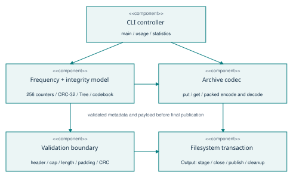
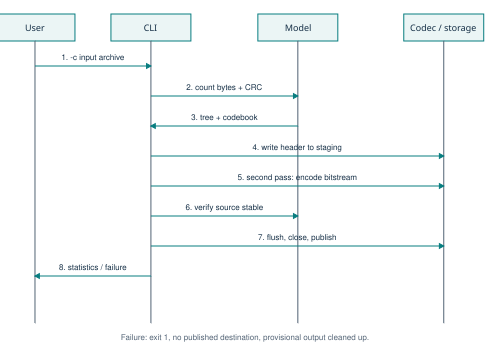
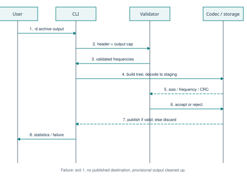

# Software Architecture and Design Specification

## 1. Document identification and stakeholders
SAD-CZIP-2.0, Team-E17, 27 October 2026. Status: proposed implementation baseline. IEEE 1016-style organization addresses context, decomposition, interfaces, behavior, and design rationale. Developer concern: deterministic coding and portability. Tester concern: reproducibility and observable failures. Evaluator concern: traceability and working behavior. User concern: lossless restoration and preservation of existing files.

## 2. Context, pattern, and constraints
The program is a layered processing pipeline: CLI controller -> frequency analysis/tree/codebook -> archive encoder or decoder -> guarded filesystem output. There are no network dependencies or background services. A static Huffman model needs two input passes to encode; decoding rebuilds the same tree from frequencies. C++17 and the standard library satisfy the original C/C++ and no-compression-library constraints.

## 3. Component view

| Logical component | Concrete implementation | Responsibility | Requirements |
| --- | --- | --- | --- |
| CLI controller | main, usage | Parse mode, paths, output cap; dispatch; print metrics and exit statuses | FR-07, FR-08, NFR-04, NFR-05 |
| Frequency/integrity analysis | compress, crc_update | Two-pass byte frequency and CRC calculation; source consistency check | FR-01, FR-03, NFR-03 |
| Huffman model | Node, Tree, codebook, bit_count | Priority queue, deterministic tie-break, prefix codes and safe weighted bit count | FR-04, FR-06 |
| Container codec | put, get, compress, decompress | Explicit byte order; header and payload serialization; strict decoding | FR-01, FR-02, FR-05, FR-06 |
| Validation boundary | require and decoder preconditions | Header bounds before tree creation; cap, length, padding, frequency, CRC checks | SEC-REQ-01, SEC-REQ-02 |
| Output transaction | Output | Unique sibling staging directory, flush/close, atomic no-replace publication, cleanup | SEC-REQ-03, NFR-04 |

These are logical components within src/czip.cpp, not separate translation units. The team scaffold's header-only demonstration is superseded; its original commits and submitted documents remain in Git history. Consolidation keeps the miniature implementation buildable without claiming that the older design's named source modules exist.

## 4. Data model and file format
| Offset (bytes) | Length | Field | Validation |
| --- | --- | --- | --- |
| 0 | 2 | Literal ASCII C Z (43 5A hex) | Must match exactly |
| 2 | 1 | Version = 1 | Unsupported versions rejected |
| 3 | 1 | Flags = 0 | Unknown flags rejected |
| 4 | 8 | Original size, uint64 little-endian | At most configured limit |
| 12 | 8 | Number of meaningful payload bits | Must equal weighted code lengths |
| 20 | 4 | CRC-32/ISO-HDLC of original bytes | Reflected polynomial EDB88320, init/final XOR FFFFFFFF |
| 24 | 2048 | 256 uint64 little-endian frequencies | Overflow-safe sum equals original size |
| 2072 | ceil(bits / 8) | Huffman payload, MSB first | Exact length; zero padding; full decode |

No filenames or paths are embedded in the archive, so archives cannot select extraction destinations. Empty inputs use size=0, bits=0, CRC=0, all frequencies zero. A one-symbol input gets one 0 bit per original byte. Small or uniform inputs may yield negative savings. This is a custom versioned container and is not compatible with PKZIP/unzip or the team's earlier native-layout scaffold headers.

## 5. Algorithm and complexity
Count byte frequencies with a 64 KiB read buffer. Insert nonzero symbols into a min-heap ordered by (frequency, minimum descendant byte). Remove the two smallest nodes, attach first as left (0) and second as right (1), and reinsert their parent until one root remains. Traverse the tree to form prefix-code vectors, giving the single leaf a 0 code. Weighted payload bits equal sum(frequency[symbol] * code_length[symbol]); guard multiplication and addition from overflow.

Encoding reads the file again and packs codes MSB first; both passes must have matching byte count, frequencies, and CRC before publication. Decoding validates all metadata first, reconstructs the deterministic tree, walks one bit at a time, checks each symbol's expected frequency, and verifies final boundaries and CRC. Nodes are owned by unique_ptr, so exception unwinding frees the entire tree.

For n bytes and alphabet size k <= 256: time O(n * maximum_code_length + k log k), with maximum depth 255; auxiliary memory O(k squared + buffer_size) because explicit code vectors can store k paths of depth k-1. With fixed k=256 this is bounded independently of n. No whole-file buffers are used. Disk space can temporarily hold the full proposed output; the decoder's declared-size cap limits expansion by default.

## 6. Behavioral views
### 6.1 Compression sequence

### 6.2 Decompression sequence

## 7. Internal API design
| Interface | Inputs | Return / side effect | Failure |
| --- | --- | --- | --- |
| compress(source, destination) | Regular file and absent output path | Stats {original, archive}; published archive | Failure exception on I/O, conflict, or changed source |
| decompress(source, destination, limit) | Archive path, absent output, uint64 byte cap | Stats; validated restored file | Failure on malformed data, cap, I/O, conflict |
| Tree(frequencies), codebook() | Validated 256 counters | Owned tree and code vectors | Allocation exception propagated |
| bit_count(frequencies, codes) | Frequencies and code lengths | uint64 weighted bit count | Overflow rejected |
| put(stream, value, bytes), get(stream, bytes) | Integer width 1, 4, or 8 | Serialized/read integer | get rejects premature EOF |
| Output(destination), commit() | Absent target and existing writable parent | Provisional stream; atomic final publication | Fail without replacing target |
| require(condition, category) | Boolean invariant and diagnostic | Continues or throws Failure | Converted to stderr and exit 1 by main |

No REST API is needed for a local utility. The CLI is its supported public interface; internal function signatures are implementation interfaces.

## 8. Error handling and security architecture
Validate signature/version/flags/size/frequencies before allocating tree nodes. Validate bit arithmetic and archive length before creating provisional output. Decode to a file owned by an exclusively created sibling directory; check data integrity before committing. create_hard_link fails atomically if any target already exists, covering the race between the initial existence check and publication. The destructor removes provisional files on handled errors. A forced process kill may leave a .czip-tmp-* directory for manual removal.

The threat model covers malicious archive bytes, truncation, malformed metadata, output conflicts, and accidental source changes. CRC is corruption detection, not protection against intentional forgery. The tool does not encrypt data. A highly privileged local adversary able to alter the process or filesystem is outside this model. Source/parent path symlink changes by an adversarial local user are not fully defended with descriptor-relative APIs. Disk quota exhaustion is reported as an I/O failure; no disk reservation is promised.

The output publication mechanism requires a hard-link-capable local filesystem. Unsupported filesystems fail explicitly. The output cap bounds decoded bytes, but the user can deliberately relax it; trusted large archives still need adequate time and disk space.

## 9. Build, deployment, and verification
Build with CMake Release or c++ -std=c++17 -O2 -Wall -Wextra -Wpedantic -Werror src/czip.cpp -o build/czip. No runtime installation or server deployment is required. CMake's sanitizer option enables ASan/UBSan for GCC/Clang. CI defines Release build/test jobs for Linux, macOS, and Windows plus a Linux sanitizer job. Remote CI is evidence only after it actually executes; local logs are separately preserved.

## 10. Traceability and design decisions
FR-01/FR-02 use pipeline stages and transactional output. FR-03/FR-04 use frequency table and deterministic tree. FR-05/FR-06 use explicit-endian codec and bounded traversal. FR-07/FR-08 use CLI controller. NFR-01/NFR-02 motivate buffered streaming. NFR-03 and SEC-OBJ-01 use CRC plus SHA-256 test comparison. SEC-OBJ-02 and SEC-REQ-01/02 use validation before allocation and sanitizer-backed negative tests. The complete requirement-to-test matrix is in the Test Plan.

Decisions: frequency-table storage favors transparency over compact headers; deterministic ties ensure reproducible archives; versioning isolates the earlier scaffold format; no-replace publication favors data preservation over overwrite convenience; bounded streaming supports the 500 MB acceptance target. Future work could add a compact canonical-code header, faster lookup decoding, and explicit cryptographic authentication through a separately reviewed format version.
