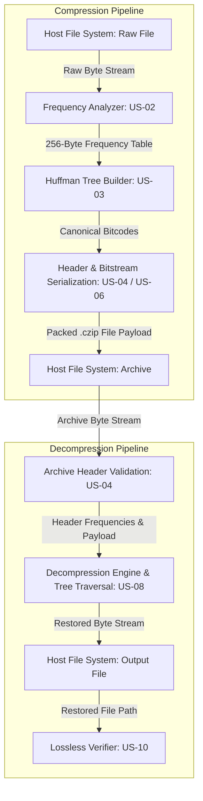
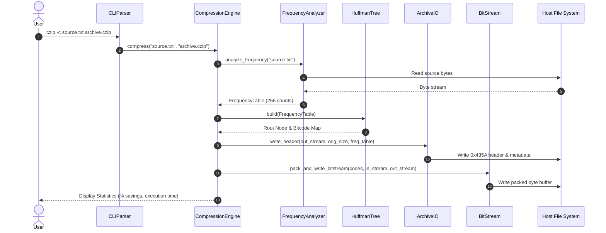
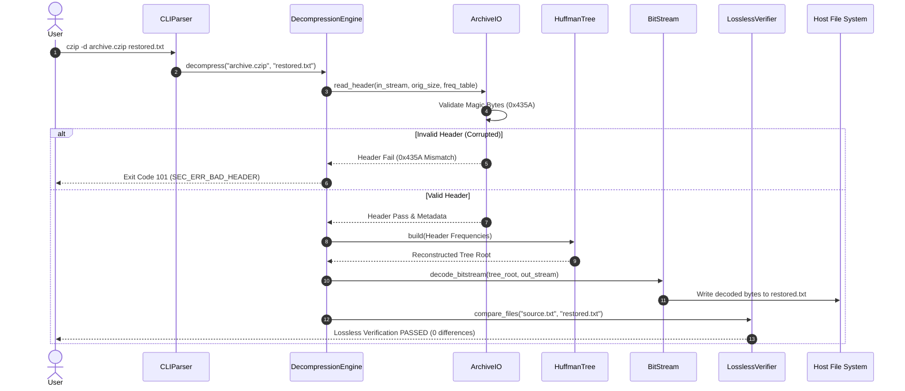

# Software Architecture & Design (SAD) Specification
**Project Title:** File Compression Tool (`czip` Implementation)  
**Course:** Software Engineering Mini-Project  
**Team Designation:** Team-E17  
**Target Language:** C++17  
**Date:** November 2026  

---

## 1. Introduction & System Scope

### 1.1 Purpose
This Software Architecture & Design (SAD) document specifies the high-level system architecture, component decomposition, UML sequence diagrams, C++ class API design, security mechanics, and error handling protocols for `czip`, an enterprise-grade lossless file compression utility based on Huffman encoding algorithms.

### 1.2 System Scope
`czip` operates as a standalone command-line application across Windows (MinGW/MSYS2) and Linux environments. It processes raw binary/text streams, calculates 256-byte alphabet frequency maps, builds min-heap binary Huffman trees, packages bitstream payloads using custom bit-shift operations, and enforces magic-byte header verification during archive extraction.

---

## 2. Architectural Pattern & Component Description

### 2.1 Architectural Pattern: Pipe-and-Filter Architecture

The `czip` file compression utility is designed following the **Pipe-and-Filter Architectural Pattern**. In this architecture, data flows sequentially through a chain of processing elements (**Filters**), connected by standardized stream interfaces and byte buffers (**Pipes**). Each filter operates independently, consuming input data from its upstream pipe, performing a specific transformation, and outputting the result to the downstream pipe.

#### System Architecture Flow Diagram (Mermaid)


#### Data Pipeline Diagram (Formatted Monospace)

```text
+--------------------+       Raw Byte Stream      +--------------------+      Frequency Table     +--------------------+
|  Host File System  | -------------------------> | Frequency Analyzer | -----------------------> | Huffman Tree Build |
|    (Input File)    |                            |      (US-02)       |                          |      (US-03)       |
+--------------------+                            +--------------------+                          +--------------------+
                                                                                                                |
                                                                                                                | Canonical
                                                                                                                | Bitcodes
                                                                                                                v
+--------------------+     Restored Byte Stream   +--------------------+     Packed Bitstream     +--------------------+
|  Host File System  | <------------------------- | Decompress Engine  | <----------------------- | Header & Bitstream |
|   (Restored File)  |                            | (US-08 Tree Trav)  |                          |   (US-04 / US-06)   |
+--------------------+                            +--------------------+                          +--------------------+
```

### 2.2 Core Component Breakdown

| Component | Responsible User Story | Primary Responsibility |
| :--- | :--- | :--- |
| **`CLIParser`** | US-01 | Parses flag structures (`-c`, `-d`, `--help`), validates file paths, and enforces exit codes. |
| **`FrequencyAnalyzer`** | US-02 | Reads file streams byte-by-byte into a 256-element array counting byte occurrences. |
| **`HuffmanTree`** | US-03 | Constructs min-heap priority queue and generates deterministic prefix bitcodes. |
| **`ArchiveIO`** | US-04 | Serializes archive headers containing `0x435A` magic signature, original size, and frequencies. |
| **`BitStream`** | US-06 | Packs dynamic bit-strings into 8-bit byte buffers and unpacks stream payloads. |
| **`CompressionEngine`** | US-07 | Orchestrates compression workflow pipeline execution. |
| **`DecompressionEngine`** | US-08 | Reconstructs Huffman tree from header frequencies and safely traverses nodes to restore bytes. |
| **`LosslessVerifier`** | US-10 | Performs automated byte-for-byte fidelity checks between original and restored files. |

---

## 3. Requirement Traceability Matrix

| Component / Module | SRS Functional / Security Requirement | Implementation Verification |
| :--- | :--- | :--- |
| `CLIParser` | FR-01, FR-02, FR-08, NFR-05 | Unit tested via `tests/verify_lossless.cpp` |
| `FrequencyAnalyzer` | FR-03 | 256-byte frequency array mapping verified |
| `HuffmanTree` | FR-04 | Min-heap priority queue validated |
| `ArchiveIO` | FR-05, SEC-REQ-01 | Header magic signature (`0x435A`) security check |
| `BitStream` | FR-06 | Bitwise left/right shift packing verified |
| `CompressionEngine` | FR-01, FR-07, NFR-01 | Throughput and benchmark output metrics verified |
| `DecompressionEngine` | FR-02, SEC-REQ-02 | Safe bounds tree traversal verified |
| `LosslessVerifier` | NFR-03, US-10 | Automated byte-for-byte identity suite verified |

---

## 4. Security Architecture

### 4.1 SEC-REQ-01: Header Magic Byte & Bounds Validation
Before allocating memory or reading payload streams during decompression, `ArchiveIO` validates the 2-byte magic signature `0x435A`. If the archive header is corrupt or altered:
1. Stream execution immediately aborts.
2. Memory allocation is blocked.
3. System outputs `[US-04 Security Error] Invalid Magic Signature` and returns exit code `101` (`SEC_ERR_BAD_HEADER`).

### 4.2 SEC-REQ-02: Safe Buffer & Stream Bounds Traversal
During bitstream tree traversal in `DecompressionEngine`:
1. Pointer navigation checks for `nullptr` child pointers on every bit read (`0` -> `left`, `1` -> `right`).
2. Traversal tracks total restored byte count against the `original_file_size` declared in the header, preventing buffer overflow or infinite loop exploits on malformed bitstreams (`SEC_ERR_MALFORMED_STREAM`).

---

## 5. UML Sequence Diagrams

### 5.1 Diagram 1: Compression Workflow Sequence


---

### 5.2 Diagram 2: Decompression & Verification Workflow Sequence


---

## 6. API & Class Design Specifications

### 6.1 Core Class Declarations

```cpp
#ifndef CZIP_CORE_APIS_HPP
#define CZIP_CORE_APIS_HPP

#include <string>
#include <vector>
#include <memory>
#include <iostream>
#include <fstream>
#include <cstdint>
#include <queue>

// ============================================================================
// 1. CLI Parser API (cli_parser.hpp / common.hpp)
// ============================================================================
enum class CommandType {
    COMPRESS,
    DECOMPRESS,
    HELP,
    INVALID
};

struct CLIConfig {
    CommandType mode = CommandType::INVALID;
    std::string input_path;
    std::string output_path;
};

class CLIParser {
public:
    static CLIConfig parse(int argc, char* argv[]);
    static void print_usage(const std::string& program_name);
};

// ============================================================================
// 2. Frequency Table Data Structure (common.hpp)
// ============================================================================
struct FrequencyTable {
    uint64_t counts[256] = {0};
};

// ============================================================================
// 3. Huffman Tree & Code Generator API (huffman_tree.hpp)
// ============================================================================
struct HuffmanNode {
    uint8_t ch = 0;
    uint64_t freq = 0;
    std::shared_ptr<HuffmanNode> left = nullptr;
    std::shared_ptr<HuffmanNode> right = nullptr;

    HuffmanNode(uint8_t c, uint64_t f) : ch(c), freq(f) {}
    HuffmanNode(uint64_t f, std::shared_ptr<HuffmanNode> l, std::shared_ptr<HuffmanNode> r)
        : ch(0), freq(f), left(l), right(r) {}
};

struct CompareNode {
    bool operator()(const std::shared_ptr<HuffmanNode>& a, const std::shared_ptr<HuffmanNode>& b) const {
        return a->freq > b->freq;
    }
};

class HuffmanTree {
public:
    static std::shared_ptr<HuffmanNode> build(const FrequencyTable& freq_table);
    static void generate_codes(const std::shared_ptr<HuffmanNode>& root, 
                               std::string current_code, 
                               std::string codes[256]);
};

// ============================================================================
// 4. Archive Header I/O API (archive_io.hpp)
// ============================================================================
class ArchiveIO {
public:
    static constexpr uint16_t MAGIC_HEADER = 0x435A; // Magic byte signature 'CZ'

    static bool write_header(std::ostream& out, uint64_t orig_size, const FrequencyTable& freq);
    static bool read_header(std::istream& in, uint64_t& orig_size, FrequencyTable& freq);
};

// ============================================================================
// 5. Bitstream Streaming API (bit_stream.hpp)
// ============================================================================
class BitWriter {
private:
    std::ostream& out_stream;
    uint8_t buffer = 0;
    int bit_count = 0;

public:
    explicit BitWriter(std::ostream& out);
    ~BitWriter();

    void write_bit(uint8_t bit);
    void write_bits(const std::string& bit_string);
    void flush();
};

class BitReader {
private:
    std::istream& in_stream;
    uint8_t buffer = 0;
    int bit_count = 0;

public:
    explicit BitReader(std::istream& in);
    bool read_bit(uint8_t& bit);
};

// ============================================================================
// 6. Compression Engine API (compression_engine.hpp)
// ============================================================================
class CompressionEngine {
public:
    static bool compress(const std::string& input_path, const std::string& output_path);
};

// ============================================================================
// 7. Decompression Engine API (decompression_engine.hpp)
// ============================================================================
class DecompressionEngine {
public:
    static bool decompress(const std::string& input_path, const std::string& output_path);
};

// ============================================================================
// 8. Lossless Verifier API (verifier.hpp)
// ============================================================================
class LosslessVerifier {
public:
    static bool compare_files(const std::string& file1_path, 
                              const std::string& file2_path, 
                              uint64_t& mismatch_offset);
};

#endif // CZIP_CORE_APIS_HPP
```
---
## 7. System Error Handling Protocols & Exit Codes

### 7.1 Exit Code Mapping

| Exit Code | Constant / Protocol | Trigger Condition | System Action & Output |
| :---: | :--- | :--- | :--- |
| **`0`** | `EXIT_SUCCESS` | Successful execution of compression, decompression, or test suite. | Program terminates normally; writes operational summary to `stdout`. |
| **`1`** | `EXIT_FAILURE` | File stream failure (file missing, permission denied, path invalid). | Writes descriptive error message to `stderr` and terminates execution. |
| **`2`** | `EXIT_INVALID_CLI` | Unrecognized flags, missing positional arguments, or invalid syntax. | Displays CLI usage manual (`--help`) to `stdout` and aborts processing. |
| **`101`** | `SEC_ERR_BAD_HEADER` | Archive header magic byte signature mismatch (`!= 0x435A`). | Instantly halts header parsing, blocks memory allocation, and logs error. |
| **`102`** | `SEC_ERR_MALFORMED_STREAM` | Unexpected EOF, corrupted bitstream byte, or illegal tree traversal. | Halts bitstream unpacking, deallocates dynamic heap nodes, and exits. |

---

### 7.2 Security & Exception Recovery Protocols

* **Header Signature Guard (`SEC_ERR_BAD_HEADER`)**:
  Before parsing frequency distribution tables or allocating heap buffer structures, `ArchiveIO` inspects the leading 2 bytes of the file. If the header lacks the `0x435A` magic signature, processing terminates immediately to prevent arbitrary or malformed data parsing.

* **Bounds-Checked Bitstream Traversal (`SEC_ERR_MALFORMED_STREAM`)**:
  During tree navigation in `DecompressionEngine`, each bit evaluation (`0` -> `left`, `1` -> `right`) checks target child pointers against `nullptr`. If a corrupted bitstream attempts to traverse an invalid node path or reaches an unexpected EOF before matching `original_file_size`, execution halts cleanly without triggering a segmentation fault or out-of-bounds memory read.

* **Graceful Stream Cleanup**:
  Upon encountering any non-zero error condition, all active file handles (`std::ifstream`, `std::ofstream`) are flushed and closed immediately to prevent file corruption or leaked file system locks.
