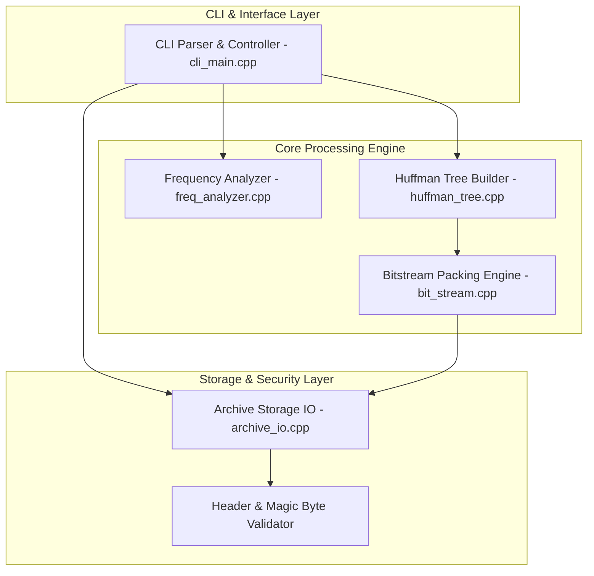
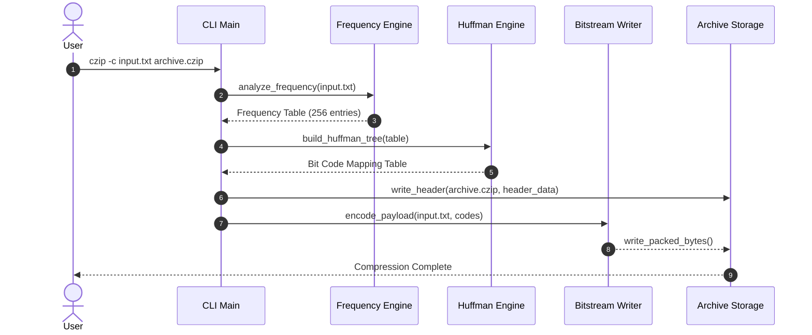
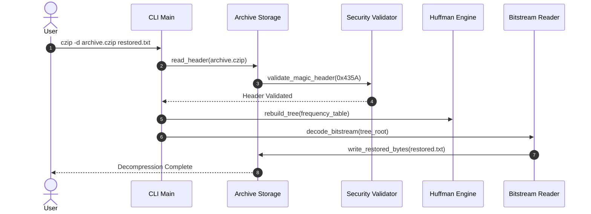

# Software Engineering Mini-Project: Deliverables Part-1

**Project Title:** File Compression Tool (Basic ZIP Implementation)  
**Course:** Software Engineering Mini-Project  
**Team Designation:** Team-E17  
**Target Language:** C / C++  
**Submission Date:** September 28, 2026  

---

### Team Members & Details
* **Mahesh Kumar B** — SRN: `PES1UG24CS255`
* **Nishanth T Chigilar** — SRN: `PES1UG24CS302`
* **Mudit Chaturvedi** — SRN: `PES1UG24CS279`

---

# PART 1: Software Requirements Specification (SRS)

## 1. Introduction

### 1.1 Purpose
This Software Requirements Specification (SRS) specifies the functional, non-functional, interface, and security requirements for the **File Compression Tool (Basic ZIP Implementation)**. The software is a command-line utility built in C/C++ using Huffman coding for lossless data compression and decompression.

### 1.2 Document Conventions
* **FR-xx**: Functional Requirement
* **NFR-xx**: Non-Functional Requirement
* **SEC-OBJ-xx**: Security Objective
* **SEC-REQ-xx**: Security Requirement
* Priority Levels: **High** (Mandatory core capability), **Medium** (Required feature), **Low** (Optional enhancement).

### 1.3 Intended Audience
This document is prepared for project developers (Team-E17), software evaluators, and system testers.

### 1.4 Project Scope
The File Compression Tool is a standalone CLI utility written in C/C++. It parses raw binary or text files, calculates byte frequency distributions, builds an optimal Huffman binary tree, serializes the tree and encoded bitstream into a custom `.czip` archive format, and restores the original file losslessly during decompression.

### 1.5 Definitions, Acronyms, and Abbreviations
* **CLI**: Command Line Interface
* **Huffman Coding**: An entropy encoding algorithm used for lossless data compression.
* **Min-Heap**: A priority queue data structure used to build the Huffman tree efficiently.
* **Header**: Metadata prepended to the archive file containing original file information and frequency mapping.

### 1.6 References
* IEEE Std 830-1998: *IEEE Recommended Practice for Software Requirements Specifications*.
* ISO/IEC 14882:2020: *Programming Languages — C++*.

---

## 2. Overall Description

### 2.1 Product Perspective
The application is a standalone command-line executable operating across Linux/POSIX and Windows CMD/PowerShell environments, interacting directly with host file systems.

### 2.2 Product Functions
1. **Compress File**: Reads input file, calculates byte frequencies, builds Huffman tree, and writes `.czip` archive with header metadata.
2. **Decompress File**: Reads `.czip` archive, parses metadata, reconstructs Huffman tree, and decodes bitstream back to original file bytes.
3. **Display Stats**: Reports original size, compressed size, compression savings percentage, and execution time (ms).
4. **Archive Integrity Check**: Validates header magic bytes and bitstream consistency before decompression.

### 2.3 User Characteristics
Users are assumed to be familiar with basic command-line interactions, file path arguments, and standard terminal flags.

### 2.4 Design and Implementation Constraints
1. **Language Constraint**: Built purely in C/C++ without third-party compression libraries (e.g., `zlib` prohibited).
2. **Memory Constraint**: Algorithm operates within O(N) auxiliary memory relative to unique byte alphabet size (max 256 unique bytes).
3. **Platform Independence**: Compiles cleanly using `GCC`, `Clang`, or `MSVC`.

---

## 3. Specific Requirements

### 3.1 Functional Requirements

| Requirement ID | Description | Priority | Measurable Acceptance Criteria |
| :--- | :--- | :--- | :--- |
| **FR-01** | **File Compression** | High | Executing `czip -c <input>` creates an output file `.czip` with serialized header and payload. |
| **FR-02** | **File Decompression** | High | Executing `czip -d <archive.czip>` reproduces original file with 100% byte identity (`cmp` clean). |
| **FR-03** | **Frequency Analysis** | High | Reads input file byte-by-byte (`0x00`–`0xFF`) and populates 256-element frequency map accurately. |
| **FR-04** | **Huffman Tree Construction** | High | Builds a deterministic binary tree using Min-Heap priority queue based on byte frequencies. |
| **FR-05** | **Header Serialization** | High | Writes 2-byte magic signature (`0x435A`), original file size, and canonical frequency table into archive header. |
| **FR-06** | **Bitstream Packing** | High | Packs variable-length Huffman codes into standard 8-bit byte buffers using bitwise shifting. |
| **FR-07** | **CLI Status Output** | Medium | Displays original size (bytes), compressed size (bytes), % savings, and execution time (ms). |
| **FR-08** | **Help & Usage Menu** | Low | Invoking `czip --help` or entering invalid flags prints usage manual to console. |

### 3.2 Non-Functional Requirements

* **NFR-01 (Throughput)**: Compression speed shall exceed **10 MB/s** on standard dual-core x86-64 processors for text/uncompressed binary files.
* **NFR-02 (Memory Overhead)**: Peak heap memory usage shall not exceed **50 MB** for input files up to 500 MB.
* **NFR-03 (Zero Data Loss)**: Lossless guarantee. Cryptographic SHA-256 hash of decompressed output must strictly match original source file SHA-256.
* **NFR-04 (CLI Feedback)**: Clear error messages printed to `stderr` upon file access failures or invalid input paths.
* **NFR-05 (Exit Codes)**: Program returns standard OS exit codes (`0` for success, `1` for execution failure, `2` for invalid syntax).

---

## 4. Security Requirements

### 4.1 Security Objectives
* **SEC-OBJ-01 (Data Integrity Assurance)**: Ensure archive files cannot be modified or truncated without immediate error detection during decompression.
* **SEC-OBJ-02 (Memory Safety & Resiliency)**: Protect host memory environment against buffer overflow vulnerabilities or out-of-bounds reads when processing invalid/corrupted files.

### 4.2 Security Requirements
* **SEC-REQ-01 (Header Magic Byte & Bounds Validation)**:
  Application shall verify magic header bytes (`0x435A`) and parse file size metadata prior to heap allocation. Invalid headers cause immediate termination with error code `SEC_ERR_BAD_HEADER`.
* **SEC-REQ-02 (Safe Buffer & Stream Traversal)**:
  Bitstream reading during tree traversal shall enforce strict bounds checking on dynamic array indices. Malformed bitstreams fail cleanly with exit code `SEC_ERR_MALFORMED_STREAM` without triggering Segmentation Faults.

---

## 5. UML Use Case Specification

### 5.1 Primary Actors
* **User / Student Evaluator**: Interacts with application via terminal commands.
* **Host Operating System / File System**: Manages disk I/O streams and memory allocation handles.

### 5.2 Use Case List
* **UC-01**: Compress Target File
* **UC-02**: Decompress CZIP Archive
* **UC-03**: Display Compression Statistics
* **UC-04**: Validate Archive Header & Integrity

### 5.3 Detailed Use Case Descriptions

#### UC-01: Compress Target File
* **Actor**: User / Student Evaluator
* **Main Success Scenario**:
  1. User inputs command: `czip -c <source_file> <output_archive.czip>`.
  2. System opens input file, calculates 256-element frequency distribution map.
  3. System constructs Huffman binary tree using Min-Heap queue and extracts variable-length bit codes.
  4. System writes header metadata (`0x435A` magic bytes, original size, frequency map).
  5. System packs bitstream payload into byte buffer and writes `.czip` archive to disk.
  6. System triggers **UC-03** to output runtime metrics.

#### UC-02: Decompress CZIP Archive
* **Actor**: User / Student Evaluator
* **Main Success Scenario**:
  1. User inputs command: `czip -d <archive.czip> <restored_file>`.
  2. System triggers **UC-04** to verify magic header signature (`0x435A`).
  3. System reconstructs Huffman tree in memory using header frequency table.
  4. System reads bitstream payload, traverses tree nodes, and writes decoded byte stream to disk.
  5. System confirms written file matches original file size.

### 5.4 UML Use Case Diagrams

```mermaid
flowchart LR
    User[User / Evaluator]
    OS[Host File System]

    subgraph Tool [File Compression Utility czip]
        UC1[UC-01: Compress Target File]
        UC2[UC-02: Decompress CZIP Archive]
        UC3[UC-03: Display Compression Stats]
        UC4[UC-04: Validate Header and Integrity]
    end

    User --> UC1
    User --> UC2

    UC1 -.->|include| UC3
    UC1 -.->|include| UC4
    UC2 -.->|include| UC4

    UC1 --> OS
    UC2 --> OS

# PART 3: Software Architecture & Design Specification

## 1. Architectural Design

### 1.1 Architectural Pattern
The system implements a **Pipeline Architecture** (Pipes & Filters pattern):

```text
[ Input File ] --> [ Frequency Analyzer ] --> [ Min-Heap Tree Builder ]
    |
[ Output File ] <-- [ Bitstream Writer ] <-- [ Huffman Bit Encoder ]
```

### 1.2 Component Structure & Module Descriptions



* **CLI Module (`cli_main.cpp`)**: Parses user arguments (`-c`, `-d`, `--help`).
* **Frequency Engine (`freq_analyzer.cpp`)**: Reads source file bytes and populates 256-element array.
* **Huffman Engine (`huffman_tree.cpp`)**: Constructs binary tree via `std::priority_queue` Min-Heap.
* **Bitstream I/O Engine (`bit_stream.cpp`)**: Manages bit-level buffer shifting and byte alignment.
* **Archive Storage Module (`archive_io.cpp`)**: Reads/writes magic header bytes (`0x435A`) and payload.

### 1.3 Security Architecture

The application uses a **Fail-Safe Staging Pipeline**. Heap allocation for decompression tree construction occurs only after validating magic header signature `0x435A`, preventing memory exhaustion attacks from malicious binary files.

---

## 2. Low-Level Design & Interfaces

### 2.1 Sequence Diagrams

#### Compression Sequence Workflow



#### Decompression Sequence Workflow

