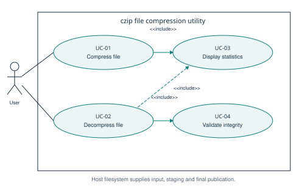

# Software Requirements Specification

## Document control
Project: File Compression Tool (czip). Team: E17. Revision: 2.0, prepared 27 October 2026. Status: implementation baseline proposed for team review. The submitted September document is preserved in SRS_Deliverable1.md and SRS_Deliverable1.pdf; this revision does not claim to have been submitted earlier. Structure follows the introduction, overall description, and specific requirements organization of IEEE 830-1998. No certification of standards conformance is claimed.

## 1. Introduction
### 1.1 Purpose and audience
Specify observable acceptance criteria for a standalone C++ command-line file compressor, for developers, testers, and the course evaluator. Requirement identifiers retain the submitted SRS identifiers so backlog, design, and tests remain traceable.
### 1.2 Scope
Compress and decompress one regular file at a time with deterministic, static Huffman coding. The custom .czip container includes metadata, byte frequencies, a bit-packed payload, and CRC-32. Compression is lossless for arbitrary byte values. ZIP interoperability, directory archiving, encryption, network access, and a graphical interface are outside scope. Incompressible or small files may grow because every archive has a 2,072-byte header.
### 1.3 Definitions and references
FR: functional requirement. NFR: non-functional requirement. CRC: cyclic redundancy check for accidental corruption. SHA-256: cryptographic digest used by tests to compare original and restored files. KiB means 1,024 bytes; MB means 1,000,000 bytes.

References: supplied Software Engineering Mini-Project Deliverables Part-1 and Part-2 briefs; original repository SRS; IEEE 830-1998 (SRS organization), IEEE 829-1998 (test-plan organization), IEEE 1016-2009 (design-description concerns); C++17 language and standard library. These are structural references; normative standards text is not reproduced.

## 2. Overall description
### 2.1 Product perspective and operating environment
A local CLI invoked by a user or automated test runner. Requires a C++17 compiler and filesystem supporting sibling temporary directories and hard links. CMake provides a portable build; a direct compiler command is also supported. macOS/Apple Clang is locally validated. Linux/GCC and Windows/MSVC are configured in CI and require an actual remote run before their status can be called verified.
### 2.2 Users and assumptions
Users can run terminal commands and choose input/output paths. Source data must remain stable during compression. Output directories must exist and be writable. The tool rejects non-regular input files. Existing destinations are never overwritten, including the original input path. There is no authentication system because the tool inherits the invoking user's filesystem permissions.
### 2.3 Constraints and dependencies
No third-party compression library. Source files are processed in two passes during compression and one pass during decompression. Fixed-size buffers and a tree with at most 511 nodes avoid memory proportional to file size. Standard-library filesystem operations require C++17. Default decompression output cap is 1 GiB; a deliberate --max-output BYTES override supports larger trusted archives. Negative savings are valid and reported.

## 3. Specific requirements
### 3.1 Functional requirements
| ID | Requirement and measurable acceptance criterion |
| --- | --- |
| FR-01 | czip -c INPUT [OUTPUT] shall produce a version-1 .czip archive and exit 0 for a readable, stable regular file and a writable, absent output. Default output is INPUT.czip. |
| FR-02 | czip -d ARCHIVE [OUTPUT] shall reproduce every input byte from a valid supported archive. Source and restored SHA-256 shall match. Default output removes a final .czip extension, otherwise appends .out. |
| FR-03 | Compression shall count all 256 byte values in unsigned 64-bit counters. Serializing bytes 0..255 repeated four times shall produce 256 counters equal to 4. |
| FR-04 | The min-heap shall order nodes by frequency, then minimum byte value in the subtree; first removed is left child. Identical inputs shall produce identical archives. |
| FR-05 | The header shall contain literal bytes 43 5A (hex), version 1, flags 0, original size, payload bit count, CRC-32, and 256 frequencies, with multibyte integers in little-endian order. Header length shall be 2,072 bytes. |
| FR-06 | Codes shall be packed most-significant bit first. Final unused bits shall be zero. A one-symbol tree shall use code 0. An empty file shall have zero payload bits. |
| FR-07 | Every successful operation shall print original bytes, archive bytes, savings to two decimals, elapsed milliseconds, and output path. Empty-input savings shall be 0.00 percent to avoid division by zero. |
| FR-08 | --help shall print usage to stdout and exit 0. Invalid syntax shall print usage to stderr and exit 2. |

### 3.2 Non-functional requirements
| ID | Requirement and measurement |
| --- | --- |
| NFR-01 | Release compression shall exceed 10 MB/s on the originally specified dual-core x86-64 reference class, measured as input bytes / wall seconds for a 500 MB text fixture and a 500 MB uncompressed binary fixture. The available ARM64 host gives supplementary evidence; the original x86-64 target remains pending. |
| NFR-02 | Peak heap shall stay below 50 MB for inputs up to 500 MB. Fixed buffers and bounded tree provide design evidence; measured peak process RSS below 50 MB is a conservative supporting check, with allocator-specific heap instrumentation still a distinct measurement. |
| NFR-03 | All positive round-trip fixtures shall have identical SHA-256 hashes before compression and after decompression. |
| NFR-04 | Missing files, invalid archives, write failures, and output conflicts shall produce a nonempty stderr diagnostic and no published partial destination. |
| NFR-05 | Exit status shall be 0 on success, 1 on execution/integrity failure, and 2 on invalid command syntax. Security identifiers shall be diagnostic categories, not process exit statuses 101/102. |

## 4. Security
### 4.1 Objectives
SEC-OBJ-01: detect accidental archive corruption and truncation before publishing restored data. A CRC is not authentication; an adversary who rewrites metadata and checksum can create another valid archive. Cryptographic authenticity is outside scope and the original absolute tamper-detection statement is clarified accordingly.

SEC-OBJ-02: reject malformed input without unsafe memory traversal, uncontrolled allocation, or modification of an existing output. Memory-safety validation combines bounded algorithms, negative tests, and AddressSanitizer/UndefinedBehaviorSanitizer.
### 4.2 Requirements
SEC-REQ-01: before building the tree, the decoder shall validate signature, version, flags, declared size against the output cap, and frequency sum using overflow-safe arithmetic. Invalid values shall exit 1 with SEC_ERR_BAD_HEADER.

SEC-REQ-02: the decoder shall reject inconsistent bit counts, unexpected archive lengths, invalid one-symbol codes, nonzero padding, frequency mismatches, wrong decoded size, and CRC mismatch with SEC_ERR_BAD_HEADER or SEC_ERR_MALFORMED_STREAM as appropriate. It shall publish no output on failure and clean up provisional data on handled errors.

SEC-REQ-03 (added): the encoder and decoder shall refuse an existing output and publish through an atomic no-replace hard link only after successful validation and close. A 1 GiB default output limit shall bound expansion; --max-output permits an explicit numeric limit.

## 5. Interfaces and use cases
### 5.1 External interfaces
CLI forms: czip -c INPUT [OUTPUT]; czip -d INPUT [OUTPUT] [--max-output BYTES]; czip --help. The limit is a decimal unsigned integer, including zero, accepted only in decompression mode and at most once. Paths containing spaces are passed as one shell argument. Source paths may begin with a hyphen because INPUT is positional. There are no network or service APIs.
### 5.2 Use-case diagram

### 5.3 Use cases
UC-01 Compress: user supplies a stable file; the system counts frequencies and CRC, constructs a deterministic tree, writes header and packed payload to provisional output, confirms second-pass content consistency, publishes, and prints statistics. On failure, exit 1 with diagnostic and remove provisional output.

UC-02 Decompress: user supplies archive and output limit; the system validates metadata, rebuilds the tree, decodes into provisional output, checks decoded count/frequencies/CRC/padding, publishes, and prints statistics. Invalid archives fail without a destination file.

UC-03 Display statistics is included by both successful operations. UC-04 Validate integrity is included by decompression. The host filesystem supplies reads, provisional writes, and atomic no-replace publication.

## 6. Acceptance and change control
All automated tests must pass; no sanitizer diagnostics are accepted. Benchmark evidence must state host, build, fixture sizes, and measurement limitations. Release review must include unresolved platform/performance evidence and the deviation log. Team review, participant-authored PRs, reviewer approval, and historical sprint evidence cannot be inferred from locally generated files.
